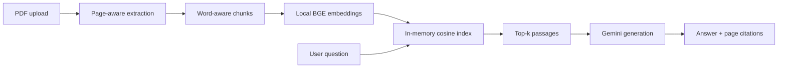

# Grounded PDF Q&A

[](https://github.com/FominP/RAGroject/actions/workflows/ci.yml)
[](https://www.python.org/)
[](LICENSE)

A compact retrieval-augmented generation (RAG) application that answers questions
about uploaded PDF documents. It performs local semantic retrieval, sends only the
most relevant passages to Gemini, and returns page-level citations with every answer.

The project is deliberately deployable without a database or paid hosting. The vector
index is kept in the user's Streamlit session and is discarded when the session ends.

## Why this is RAG

The original prototype summarized fixed slices of a document and only inspected the
first 12,000 characters for Q&A. This version indexes the entire document and runs an
explicit retrieval step before generation.



## Features

- Retrieval across the complete PDF instead of a prefix of the document.
- Page-preserving, word-aware chunks with overlap and no tokenizer download.
- Local ONNX embeddings through FastEmbed; document embeddings do not leave the app.
- In-memory cosine-similarity index with no external vector database.
- Provider-neutral generation interface and a Gemini implementation.
- Page citations and expandable source passages for answer inspection.
- Basic prompt-injection guard: document text is explicitly treated as untrusted data.
- Upload limits, API timeouts, retries, and a per-session demo quota.
- Unit tests and GitHub Actions CI without live API calls.

## Design decisions

### Why no vector database?

A single PDF normally produces hundreds, not millions, of chunks. A normalized NumPy
matrix is faster to start, easier to inspect, and avoids a stateful paid service. A
vector database becomes useful when documents must persist across sessions or be
shared between users.

### Why local embeddings?

Retrieval remains free and usable even when no Gemini key is configured. Only the
retrieved passages are sent to the generation provider. The default
`BAAI/bge-small-en-v1.5` model is small enough for CPU-only demo hosting.

### Privacy boundary

Uploaded files and embeddings live only in the active Streamlit process. Relevant
passages are sent to Gemini when generating an answer. Do not use the public demo for
confidential or regulated documents.

## Run locally

Requirements: Python 3.12.

```bash
git clone https://github.com/FominP/RAGroject.git
cd RAGroject
python -m venv .venv
source .venv/bin/activate
pip install -r requirements.txt
streamlit run app.py
```

The app works in retrieval-only mode without an API key. To generate answers, either
enter a Gemini API key in the sidebar or create `.streamlit/secrets.toml`:

```toml
GEMINI_API_KEY = "your-key"
GEMINI_MODEL = "gemini-2.5-flash-lite"
EMBEDDING_MODEL = "BAAI/bge-small-en-v1.5"
```

The model names are configuration rather than code so they can be changed as provider
offerings evolve.

## Free deployment on Streamlit Community Cloud

1. Fork this repository or push the branch to your public GitHub repository.
2. Open [share.streamlit.io](https://share.streamlit.io/) and choose **Create app**.
3. Select the repository, branch, and `app.py` entrypoint.
4. In **Advanced settings → Secrets**, add at least:

   ```toml
   GEMINI_API_KEY = "your-key"
   ```

5. Deploy. The first document takes longer while the embedding model is downloaded.

Streamlit Community Cloud and the Gemini Developer API both have free usage options,
but their quotas and availability can change. Free Streamlit apps also hibernate when
unused. This setup is intended for a portfolio demo, not an SLA-backed production
service.

## Docker

```bash
docker build -t grounded-pdf-qa .
docker run --rm -p 8501:8501 \
  -e GEMINI_API_KEY="your-key" \
  grounded-pdf-qa
```

Open <http://localhost:8501>.

## Quality checks

```bash
pip install -r requirements-dev.txt
ruff check .
pytest
```

The tests cover chunk boundaries and page metadata, vector ranking, grounded prompt
construction, prompt-injection instructions, and unsafe PDF inputs. Live model calls
are intentionally mocked out of CI.

## Limitations and next steps

- Scanned PDFs require an OCR stage and are currently rejected.
- PDF tables and multi-column layouts may lose structure during text extraction.
- The default embedding model is optimized for English. A supported multilingual
  FastEmbed model can be selected with `EMBEDDING_MODEL`.
- Citations are requested from the model and accompanied by the actual retrieved
  passages, but they are not yet verified automatically.
- A portfolio-grade evaluation set should report retrieval Recall@k, MRR, citation
  accuracy, answer faithfulness, and latency for representative documents.

## License

[MIT](LICENSE)
